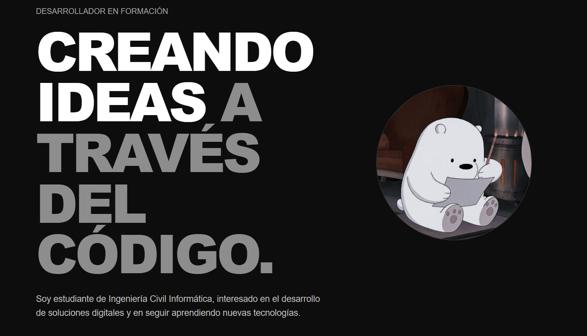
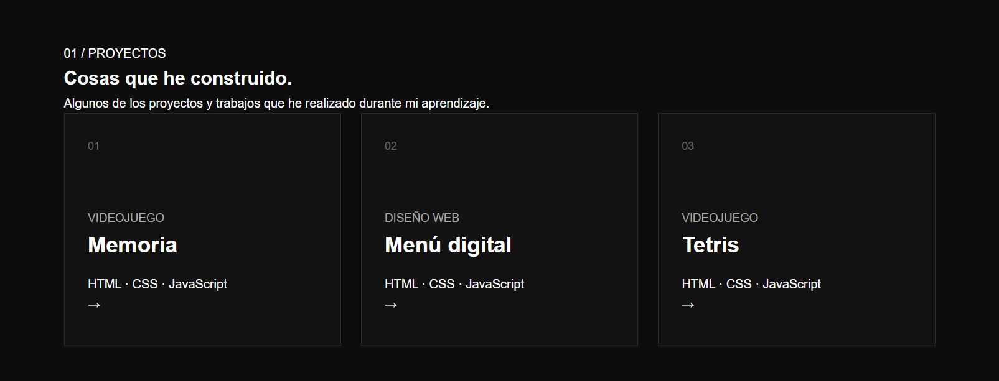
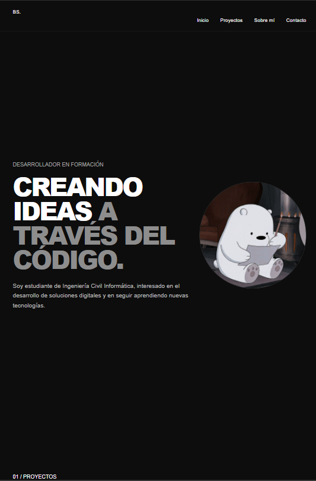
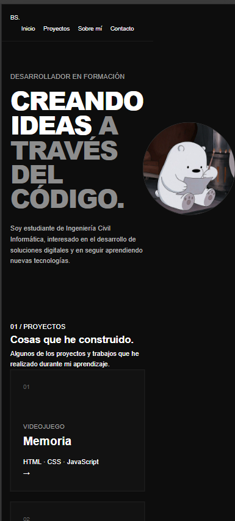

# Portafolio de Bayron Salgado — Evaluación 4

Este proyecto adapta mi portafolio de la Evaluación 2 a React
y TypeScript para Desarrollo de Frontend.

Conserva la información, la fotografía y los proyectos originales.
Se agregaron navegación con React Router, validación del formulario
y una sección con mis repositorios públicos de GitHub.

## Cómo ejecutar el proyecto

Necesitas Git, Node.js y npm.

Clona el repositorio:

```bash
git clone https://github.com/bayrons2007/evaluacion_4-bayron_salgado.git
cd evaluacion_4-bayron_salgado
```

Instala las dependencias:

```bash
npm ci
```

Inicia el servidor:

```bash
npm run dev
```

Abre la dirección que indique la terminal.
Para detener el servidor, presiona Ctrl + C.

### Otros comandos

- `npm run build`: comprueba TypeScript y genera la versión de producción.
- `npm run lint`: revisa el código con ESLint.
- `npm run preview`: muestra la compilación después de ejecutar build.

## Páginas

- **Inicio:** presentación personal y fotografía.
- **Proyectos:** Memoria, Menú digital, Tetris y repositorios de GitHub.
- **Sobre mí:** información personal y académica.
- **Contacto:** formulario con validación.
- **Página 404:** aparece al visitar una dirección inexistente.

El menú utiliza React Router e identifica la página activa.

## Qué conservé y qué cambié

Recuperé los textos, la fotografía, los estilos y los tres
proyectos de la Evaluación 2.

Separé las secciones en páginas y componentes de React.
Memoria, Menú digital y Tetris conservan sus archivos de
HTML, CSS y JavaScript.

Las diferencias visuales más notorias son el encabezado adaptado
a las rutas y la sección de GitHub debajo de los proyectos.

También corregí los enlaces de regreso, la distribución de Inicio
en móvil y el contraste del texto del pie de página.

El detalle está en [INVENTARIO.md](INVENTARIO.md).

## Referencia del portafolio original

Repositorio de la Evaluación 2:
https://github.com/bayrons2007/Frontend-

Las siguientes capturas corresponden al portafolio original:









## API de GitHub

Elegí esta API porque permite mostrar mis trabajos y mantiene
la temática del portafolio.

La aplicación realiza una consulta GET a:

```text
https://api.github.com/users/bayrons2007/repos?sort=updated&direction=desc&per_page=6
```

Obtiene hasta seis repositorios públicos, ordenados por su
actualización más reciente. No requiere contraseña ni token.

### Datos utilizados

La respuesta es una lista de repositorios.
De cada uno, la aplicación utiliza:

| Campo | Tipo | Uso |
|---|---|---|
| id | number | Identificar la tarjeta. |
| name | string | Mostrar el nombre. |
| description | string o null | Mostrar la descripción. |
| html_url | string | Abrir el repositorio. |
| language | string o null | Mostrar el lenguaje principal. |
| stargazers_count | number | Mostrar las estrellas. |

Si no hay descripción o lenguaje, se muestra un texto alternativo.

### Funcionamiento

La consulta se realiza con fetch desde un servicio separado.
El componente la inicia con useEffect y gestiona los estados
con useState.

Mientras consulta, muestra un aviso de carga. Si falla,
muestra un error y un botón Reintentar. También contempla
una respuesta sin repositorios.

La limpieza del efecto evita actualizar el componente con
respuestas que lleguen después de abandonarlo.

Los resultados se guardan temporalmente en memoria y se
comparte una petición si ya hay otra en curso.
Al recargar la página, la caché en memoria se borra.

La consulta requiere conexión y depende de la disponibilidad
y los límites de solicitudes de GitHub.

Documentación:
https://docs.github.com/en/rest/repos/repos#list-repositories-for-a-user

## Formulario

Los campos se controlan mediante useState.

Se comprueba que:
- Los campos estén completos.
- El correo tenga un formato válido.
- Los valores no contengan solamente espacios.
- El mensaje tenga al menos 10 caracteres después de quitar
  los espacios de los extremos.

Con datos válidos, aparece una confirmación y se limpian los campos.

**Es una demostración: no envía correos ni guarda los mensajes.**

## Organización del proyecto

- `src/pages`: páginas del portafolio.
- `src/components`: encabezado, pie, tarjetas, formulario y sección de GitHub.
- `src/data`: información de los proyectos originales.
- `src/services`: consulta a GitHub y caché.
- `src/types`: tipos de los datos recibidos.
- `public/proyectos`: los tres proyectos originales.
- `docs/capturas-e2`: capturas de referencia.

ProjectCard recibe props tipadas y utiliza los datos definidos
en src/data/proyectos.ts.

## Pruebas realizadas

### Código

- `npm run build`: completado sin errores después de las correcciones finales.
- `npm run lint`: sin problemas reportados.

### Navegación y proyectos

- Navegación entre las páginas del portafolio.
- Página 404 y regreso al inicio.
- Enlaces de regreso de los proyectos originales.
- Memoria: voltear cartas, encontrar parejas y reiniciar.
- Menú digital: cambiar los filtros por categoría.
- Tetris: mover, girar y reiniciar.

### Formulario

- Campos vacíos.
- Correo inválido.
- Mensaje demasiado corto.
- Datos válidos, confirmación y limpieza de los campos.

### GitHub

- Carga de repositorios y apertura de sus enlaces.
- Aviso de error con una dirección de API inexistente.
- Recuperación al restaurar el endpoint correcto.
- Recuperación con Reintentar después de restablecer la conexión.
- En Network, al ir a Sobre mí y volver a Proyectos sin recargar,
  no se agregó otra petición a la API.

### Diseño y accesibilidad

- Comparación visual con el portafolio original.
- Revisión de las cuatro páginas a 375 px.
- Corrección de Inicio para colocar la fotografía debajo del texto en móvil.
- Navegación con Tab y Enter, comprobando el foco visible.
- Recorrido de los campos y el botón del formulario con teclado.

Ejecuté Lighthouse en /contacto y obtuve inicialmente 96 en
accesibilidad por el contraste del pie de página.

Cambié el texto de #666666 a #a8a8a8 y repetí la auditoría:
obtuvo 100 en accesibilidad.

Ese resultado corresponde a Contacto y no garantiza
la accesibilidad completa de todo el sitio.

## Avisos de dependencias

Durante el desarrollo, npm audit informó 11 avisos de seguridad
relacionados con dependencias de desarrollo.
En esa comprobación, npm audit --omit=dev reportó 0 vulnerabilidades.

No apliqué la corrección forzada porque proponía un cambio
incompatible de versión de Vite. La revisión de esos avisos
sigue pendiente.

## Trabajo con Git

Organicé el desarrollo en ramas:

- feat/base-react
- feat/navegacion
- feat/formulario
- feat/api-github
- docs/entrega

Las funcionalidades se integraron mediante pull requests.
La documentación y las correcciones finales se prepararon
en docs/entrega para su revisión e integración.

## Uso de inteligencia artificial

Utilicé ChatGPT como apoyo para interpretar la pauta, recibir
propuestas de código, resolver problemas y preparar documentación.

Los aportes recibidos, los ajustes, las pruebas y la reflexión
están registrados en [uso_ia.md](uso_ia.md).